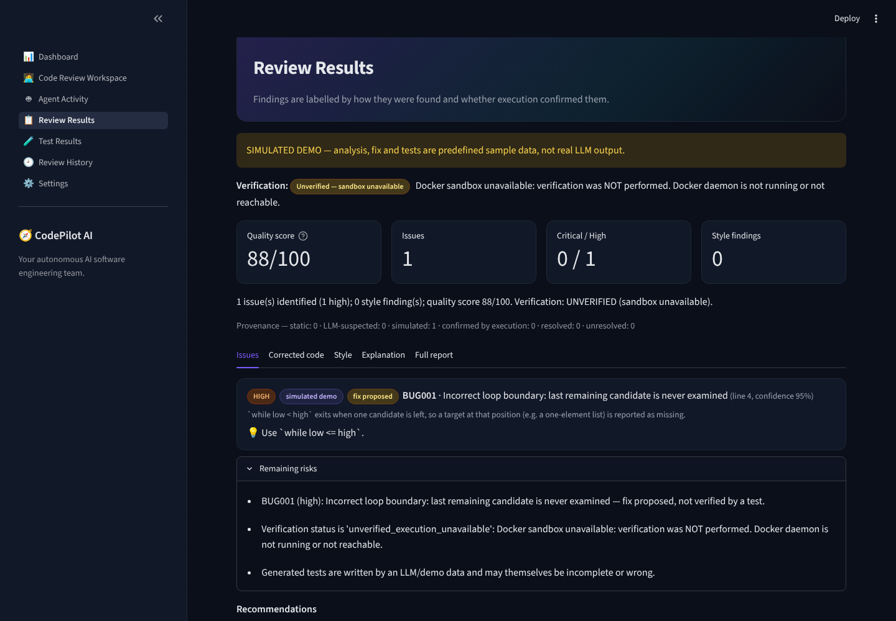
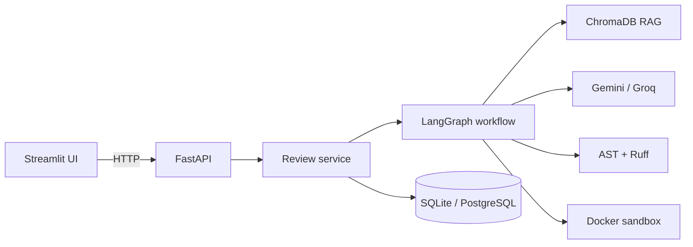

# 🧭 CodePilot AI

**Your autonomous AI software engineering team.**

CodePilot AI is a multi-agent platform that reviews, debugs, repairs and *validates* source code. Instead of a chatbot that
says "looks fixed to me", it behaves like a small engineering team: it analyses the code, hunts bugs, proposes a fix, writes tests,
runs them in an isolated Docker sandbox, loops back to the fixer when tests fail (bounded to 3 attempts), and produces a report that
states exactly **what was found how, and what was actually verified**.



---

## 1. Problem statement

AI code assistants are fluent but unaccountable: they report bugs that do not exist, "fix" code they never ran, and sound equally
confident either way. Engineers need to know *which* findings are mechanical facts, which are an LLM's suspicion, and whether a proposed
fix was ever executed. CodePilot AI makes that provenance the core of the product:

| Label | Meaning |
|---|---|
| **static** | Found by AST rules / Ruff. Deterministic; line numbers come from the tool. |
| **llm_suspected** | Reported by an LLM. A hypothesis until an executed test confirms it. |
| **confirmed_by_execution** | A generated test **failed on the original code** and demonstrates the issue. |
| **resolved** | …and that test **passes on the corrected code**. |
| **unresolved** | Confirmed by execution but still failing after the repair loop. |
| **demo_simulated** | Predefined sample data. Never presented as real LLM analysis. |

The report only says **"verified"** when tests were really executed in the sandbox, all pass on the corrected code, *and* at least one
failed on the original (otherwise: "tests passed, but they don't demonstrate the fix"). If Docker is unavailable, verification is
**disabled and said so** — there is no silent fallback to unsafe local execution.

## 2. Features

- **Six cooperating agents** — Bug Finder, Style & Quality, Fixer, Test Writer, Validator, Report — orchestrated by **LangGraph**.
- **Automatic intent detection** (DEBUG, REVIEW, EXPLAIN, TEST, OPTIMIZE, SECURITY_AUDIT) with a structured-output classifier,
  a rules fallback, and a *safe general REVIEW workflow when confidence is low*. Each intent runs its own plan.
- **Agentic RAG** over a 9-document knowledge base in **ChromaDB** (Python/Java/C standards, debugging patterns, data structures, complexity,
  runtime errors, secure coding, testing). Retrieval is decided per intent, filtered by category and language, returns real
  `file § section` references, and never fabricates sources. If the embedding API is down it falls back to a local embedder.
- **Hardened Docker execution** — non-root, network off, read-only FS, CPU/memory/PID limits, timeout, no host env, no Docker socket in the sandbox.
- **Bounded repair loop** — failures are fed back to the Fixer, max 3 attempts, then reported as *failed* (never loops forever).
- **Regression detection** — tests that passed on the original but fail on the fix are surfaced.
- **Transparent quality score** — a deterministic formula, not an LLM opinion.
- **Provider abstraction** — Google Gemini and Groq via environment variables; model names live only in configuration.
- **Demo mode** — works with no API key; clearly labelled `SIMULATED`.
- **Live agent activity** — the UI shows real node executions and timings (polled from the API), nothing fabricated.
- **Evaluation framework** — 34 hand-designed benchmark programs, machine-validated, with honest "not measured" reporting.
- **Security** — input/file validation, prompt-injection resistance, secret redaction in logs, rate limiting, request timeouts.

## 3. Architecture



More detail (state, plans, provenance model, schema, design decisions): [`docs/architecture.md`](docs/architecture.md).

## 4. Multi-agent workflow

```
START → intent → router → {debugging | code_review | explanation} → retrieve → static → bug_finder → style
      → fixer → tests → validate ──(failures & attempts < 3)──▶ repair ──▶ validate …
                                  └─(otherwise)──▶ report → END
```

| Intent | Plan |
|---|---|
| DEBUG, REVIEW | retrieve → static → bugs → style → fix → tests → validate → report |
| SECURITY_AUDIT, OPTIMIZE | retrieve → static → bugs (security / performance focus) → fix → tests → validate → report |
| EXPLAIN | retrieve → static → explain → report |
| TEST | retrieve → static → tests → validate (against the *original*) → report |

Conditional edges follow the plan, so steps that don't apply never run (and never appear in the activity view).

## 5. Technology stack

Python 3.11+ · FastAPI + Pydantic · SQLAlchemy (SQLite, PostgreSQL-ready) · LangGraph · LangChain prompt templates + LCEL ·
ChromaDB · Ruff + Python `ast` · Pytest · Docker · Streamlit · pandas · httpx · python-dotenv.

## 6. Quick start

```bash
git clone <this repo> && cd codepilot-ai
python -m venv .venv && source .venv/bin/activate
pip install -r requirements.txt
cp .env.example .env            # optional: add GEMINI_API_KEY or GROQ_API_KEY
bash scripts/build_sandbox.sh   # optional: enables test execution / verification (needs Docker)
bash scripts/run_dev.sh         # API on :8000, UI on :8501
```

Open <http://localhost:8501>, expand **Demo samples**, pick one and tick **Use simulated demo analysis** — no API key needed.
Interactive API docs: <http://localhost:8000/docs>. Full instructions: [`docs/setup.md`](docs/setup.md).

### Environment configuration (`.env`)

| Variable | Purpose | Default |
|---|---|---|
| `LLM_PROVIDER` | `gemini`, `groq` or `none` | `gemini` |
| `GEMINI_API_KEY` / `GROQ_API_KEY` | Credentials (never logged, never shown in full) | *(empty → no-LLM mode)* |
| `GEMINI_MODEL` / `GROQ_MODEL` / `EMBEDDING_MODEL` | Model names (configured only here; provider catalogues change — update them if you see 404 / `model_not_found`) | `gemini-flash-latest` / `openai/gpt-oss-120b` / `gemini-embedding-2` |
| `DATABASE_URL` | Any SQLAlchemy URL (e.g. PostgreSQL) | `sqlite:///./data/codepilot.db` |
| `MAX_CODE_BYTES`, `MAX_UPLOAD_BYTES` | Input limits | 200000 |
| `RATE_LIMIT_PER_MINUTE` | POSTs per IP | 30 |
| `MAX_REPAIR_ATTEMPTS` | Repair loop bound (hard-capped at 3) | 3 |
| `SANDBOX_IMAGE`, `EXEC_*` | Sandbox image, timeout, memory, CPUs, PIDs, output cap | see `.env.example` |

### Docker Compose

```bash
docker compose up --build        # API + UI; execution is DISABLED here by default (no daemon access) and the UI says so
```
To enable verification either run the API on the host (recommended) or opt in with `docker-compose.exec.yml` (mounts the Docker socket
into the **API** container — read the warning in that file).

## 7. Using the API

| Method & path | Purpose |
|---|---|
| `POST /api/review` | Review; intent auto-detected (or set `intent`) |
| `POST /api/debug` · `/explain` · `/generate-tests` · `/optimize` · `/security-audit` | Same pipeline with the intent forced |
| `GET /api/reviews` · `GET /api/reviews/{id}` · `DELETE /api/reviews/{id}` | History |
| `GET /api/health` | DB, LLM mode, sandbox availability, embedder |
| `GET /api/stats`, `/api/samples`, `/api/settings`, `POST /api/upload` | Dashboard, demo data, provider status, validated upload |

```bash
curl -s localhost:8000/api/review -H 'content-type: application/json' -d '{
  "code": "def avg(xs):\n    return sum(xs)/len(xs)\n",
  "description": "avg crashes on empty lists"
}' | jq '{intent, analysis_mode, verification_status, issues: [.issues[] | {id, source, status}]}'
```
Set `"background": true` for a `202` + polling (`GET /api/reviews/{id}` returns the live trace while `status` is `running`).
Errors: `422` invalid input, `413` too large, `415` bad file type, `429` rate limited, `404` unknown id.

## 8. Testing & evaluation

```bash
python -m pytest                                  # 89 tests: static rules, agents, graph, API, RAG, sandbox command/timeouts, UI
python -m evaluation.benchmark --validate-dataset # machine-check the 34-case benchmark
python -m evaluation.benchmark --mode static      # static baseline (no LLM, no Docker)
python -m evaluation.benchmark --mode all --write-docs   # + validator & full pipeline when Docker / an API key are available
```

**Measured results** (see [`docs/evaluation.md`](docs/evaluation.md); regenerated by the script, never hand-edited):

| | Result |
|---|---|
| Benchmark | 34 programs (6 correct, 21 functional bugs, 4 security, 3 style) — every defect's tests fail on the buggy code and pass on the reference fix |
| Static baseline recall | 20% overall (security 75%, boundary 0%, logic 14%, runtime 17%) |
| Static false-positive rate | 0 / 6 correct programs flagged |
| Full LLM pipeline, fix success, test pass rate, regression detection, sandbox reliability | **Not measured in the build environment** (no LLM key, no Docker daemon). The scripts exist and report exact numbers when run with those available. |

The low static recall is expected and is the point: logic and boundary bugs need LLM reasoning *plus* execution.

## 9. Security model

- **Untrusted input:** submitted code, uploads and retrieved documents are wrapped in `<untrusted_code>` / `<reference_docs>` delimiters,
  delimiter look-alikes are neutralised, injection phrases are detected and surfaced as warnings, and the intent classifier never sees the code.
- **Execution:** only in Docker (see §Features). Unavailable Docker ⇒ no execution, explicit "unverified".
- **Secrets:** redaction filter on every log line and LLM error body; settings API returns only the last 4 characters; keys can't be entered via the UI.
- **API:** Pydantic validation, size/type limits, per-IP rate limiting, generic 500s (details only in server logs), CORS restricted to the UI origin.

## 10. Honest limitations

- **Verified here:** all agent/graph/API/RAG/UI logic via tests with a scripted fake LLM and a test-only local pytest runner standing in for Docker;
  the live API and Streamlit app were run and driven through a real browser (screenshots in `docs/screenshots/`).
- **Not exercised in the build environment:** real calls to Gemini/Groq (no keys; default model names were checked against the providers' 2026 deprecation pages but never called), and real container execution/image build (no Docker daemon).
  The `docker run` command construction, timeout-kill, cleanup, output truncation and the unavailable path are unit-tested.
  First run with a real daemon: `bash scripts/build_sandbox.sh` and `python -m evaluation.benchmark --mode validator`.
- Execution & test generation: **Python only**. Java and C get LLM + heuristic analysis (clearly labelled), no execution.
- The offline retrieval fallback is *lexical* (hashed features), not semantic.
- LLM-written tests can be wrong; the report says so and the 3-attempt cap prevents endless "fixing" of a bad test.

## 11. Project structure

```
backend/   FastAPI app: api/ core/ (config, security, logging, rate limit) database/ models/ schemas/ services/
agents/    intent_router, bug_finder, style_agent, fixer_agent, test_writer, validator, report_agent, explain_agent,
           static_analysis, llm (providers + LCEL), demo_data, state, graph
rag/       ingestion, embeddings (+ offline fallback), retriever, knowledge_base/ (9 documents)
execution/ docker_runner.py, Dockerfile (sandbox image)
evaluation/ benchmark.py, metrics.py, datasets/cases.py, results/
frontend/  Streamlit app + 7 pages + components
tests/ docs/ scripts/ docker/
```

## 12. Resume / portfolio notes

See [`docs/resume.md`](docs/resume.md) for accurate bullet points and interview talking points (no inflated metrics).

## License

MIT — see [LICENSE](LICENSE).
