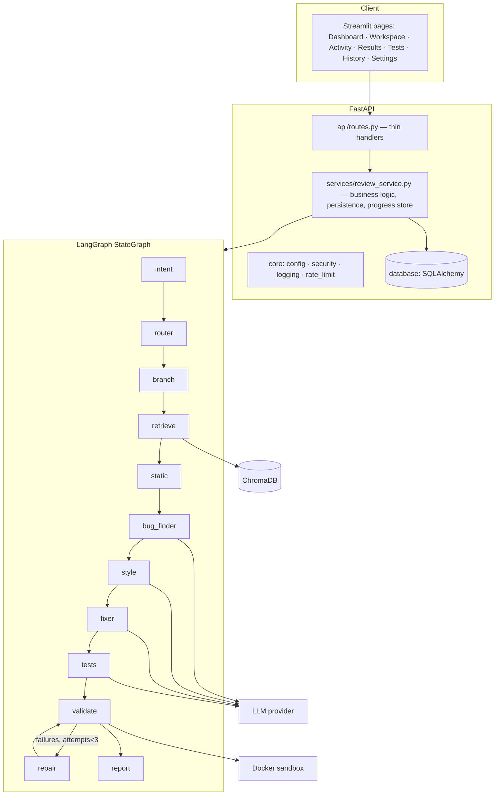

# Architecture

## 1. Components

*Business logic is kept out of route handlers:* routes validate and delegate to `review_service`, which runs the graph (optionally on a
worker thread with live progress), persists issues / tests / report, and answers history queries.

## 2. Shared state (`agents/state.py`)

`ReviewState` carries: request, code, language, intent (+ confidence/source), plan, analysis mode, retrieved context, static findings & metrics,
bug analysis (`issues`), style analysis, corrected code & changes, generated tests, original/corrected execution results, verification verdict,
repair attempts/log, final report, plus two append-only lists (`trace`, `notes`).

Every node is wrapped by `@traced`, which records a **real** trace entry (start time, duration, status `completed | degraded | skipped | failed`,
summary) and isolates failures: an LLM outage degrades one node, never the whole run. Static findings collected before an LLM failure are kept.

## 3. Intent → plan

`agents/intent_router.py` holds `PLANS` (see README). Classification order: user-selected mode → LLM structured output → keyword rules.
Only the *request text* is classified (never the code). Confidence < 0.5 ⇒ the safe general REVIEW workflow. The router node then follows a
conditional edge into one of three workflow branches (debugging / code review / explanation), which all converge on `retrieve`;
after that, `_next(node)` conditional edges walk the plan.

## 4. Analysis modes (always shown in UI and report)

| Mode | When | Behaviour |
|---|---|---|
| `llm` | A provider key is configured | Static + LLM agents. LLM findings are *suspected* |
| `static_only` | No key | AST/Ruff findings only; no fix/tests; says so |
| `demo_simulated` | Unmodified demo sample, demo requested or no key | Predefined issues/fix/tests, labelled SIMULATED. Real static findings are never relabelled as simulated. If Docker exists the predefined tests are *really executed* |

## 5. Issue provenance and verification

Issue fields: `source` (static / llm_suspected / demo_simulated), `status` (open / fix_proposed / resolved / unresolved), `verification`
(unverified / confirmed_by_execution / confirmed_by_execution_and_fixed). The Test Writer tags each test with the issue ids it targets
(`covers`). The Validator runs the tests on the **original** and on the **corrected** code, then:

* failed-on-original & passes-on-corrected → `resolved` (confirmed by execution)
* failed-on-original & still fails → `unresolved`
* otherwise the issue stays `fix_proposed` / `open` — never "verified" by inference.

Run-level verdict (`verification.status`): `verified`, `passed_no_discrimination`, `failed`, `tests_run_on_original`, `unverified_no_tests`,
`unverified_execution_unavailable`, `execution_failed`, `not_applicable`. Regressions = tests that passed on the original but fail on the fix.

## 6. Bounded repair loop

`validate → (needs_repair?) → repair → validate`. `needs_repair` requires: a corrected file, executed tests with failures, no timeout, an LLM able to
repair, and `repair_attempts < min(MAX_REPAIR_ATTEMPTS, 3)`. LangGraph's `recursion_limit` is an additional hard stop. After the cap the review ends as
`failed` verification with unresolved issues listed in *Remaining risks*.

## 7. RAG

Ingestion: front-matter parsing → section-aware chunking (900 chars, 120 overlap) → embeddings → Chroma upsert (cosine). One collection per embedder
(`codepilot_kb_<embedder>`), so vectors from different backends are never mixed. `plan_retrieval` maps intent → categories (e.g. SECURITY_AUDIT →
`security`, `runtime_errors`), filters by language, drops hits beyond a distance threshold, and returns `source § section` references only for chunks that exist.
Embedder: Gemini (when configured) → local hashing embedder on any failure. Retrieval failure never blocks the review.

## 8. Sandbox (`execution/docker_runner.py`)

`docker run --rm --network none --read-only --tmpfs /tmp --user 10001:10001 --cap-drop ALL --security-opt no-new-privileges --cpus --memory --memory-swap
--pids-limit --ulimit nofile`, code mounted **read-only** from a fresh temp dir that is deleted afterwards, a scrubbed environment (the docker *client* gets
only PATH/HOME/DOCKER_*; the container gets nothing from the host), a wall-clock timeout that `docker kill`s the container, and output truncation.
Docker or the image missing ⇒ `ExecutionResult(available=False)` and no code runs anywhere.

## 9. Database

`users` (optional) · `code_reviews` (id, source, language, intent, status, summary, quality_score, analysis_mode, verification_status, duration, error) ·
`review_issues` (FK, indexed on review_id & severity) · `review_tests` (FK, indexed on status) · `review_reports` (final report JSON, trace JSON,
verification status). Cascading deletes; JSON columns keep the schema portable to PostgreSQL (`DATABASE_URL`).

## 10. Design decisions and assumptions

1. **No LLM numbers.** The quality score is a fixed formula over static findings; verification wording is derived from execution facts in code.
2. **REST through httpx** rather than vendor SDKs: explicit timeouts, fewer dependencies, easy to add providers (`LLMProvider.generate`).
3. **Line numbers are validated** against the code; out-of-range LLM line numbers are dropped and noted.
4. **Python-only execution** to keep the sandbox small and the claims honest; the language registry in `static_analysis.analyze` is the extension point.
5. **Single local user:** `users` exists but is optional. "Delete own history" is a plain delete; add auth before multi-tenant use.
6. **Synchronous default, async optional:** API calls run in the FastAPI threadpool; `background=true` returns 202 and publishes live progress from an in-memory store
   (a process-local store — use Redis/Celery if you scale to multiple workers).
7. **Demo data is code-checked:** tests assert each predefined sample really fails on the buggy code and passes on the fix, and that demo line numbers are right.
8. **API-key settings are read-only in the UI.** Provider/model can be switched for the running process; keys come from the environment.
